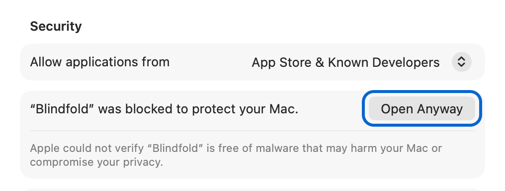

<p align="center">
  
</p>
<h1 align="center">Blindfold</h1>
<p align="center">Clean your Mac’s screen, keyboard, trackpad, and mouse without accidental input.</p>
<p align="center">
  <strong><a href="https://github.com/dvoyevoda/blindfold/releases/latest">Download for macOS</a></strong>
  · macOS 14 or later · <a href="LICENSE">MIT License</a>
</p>
<p align="center">
  
</p>

## Get started

1. Open the **DMG**, drag **Blindfold.app** to **Applications**, then open it from there.
2. Choose what to pause and click **Start Cleaning**. For keyboard or pointer input, grant **Accessibility** and, if requested, **Input Monitoring** in **System Settings → Privacy & Security**.
3. Hold **Esc** for three seconds to finish, or let the auto-unlock timer expire. Choose **Never** for a session without a timer.

### If macOS blocks the first launch

Blindfold is ad hoc signed. For a copy from the official GitHub release, click **Done** in the alert, then open **System Settings → Privacy & Security**. Scroll to **Security**, click **Open Anyway** next to Blindfold, and confirm. [Apple’s first-launch instructions](https://support.apple.com/en-us/102445#openanyway)



## Cleaning controls

- **Keyboard** pauses keystrokes and supported function-row controls.
- **Trackpad & Mouse** pauses pointer movement, clicks, and scrolling.
- **Display** blacks out every connected screen, including external monitors, so fingerprints and smudges are easier to see. One screen shows the cleaning status.
- **Backlight** turns off the built-in keyboard lighting on supported Macs and restores it afterward.

Blindfold runs locally without telemetry. The power button and Touch ID stay under macOS control.

## Build from source

Use macOS 14 or later with Xcode or the Command Line Tools and Swift 6 or later.

```sh
git clone https://github.com/dvoyevoda/blindfold.git
cd blindfold
./scripts/build-app.sh
open .build/Blindfold.app
```

To package the DMG, install [uv](https://docs.astral.sh/uv/) and run `./scripts/package-dmg.sh` after building.

## Contributing

Report bugs in [GitHub Issues](https://github.com/dvoyevoda/blindfold/issues). To submit a change, fork the repo, run the [tests and relevant manual checks](docs/testing.md), then open a pull request against `main` with a summary and your test results.

## License

Blindfold is available under the [MIT License](LICENSE) and maintained by [@dvoyevoda](https://github.com/dvoyevoda).
